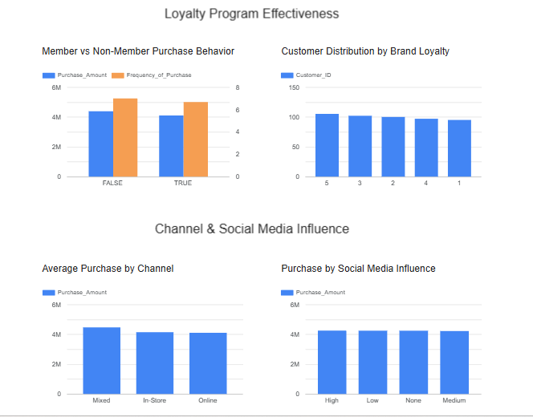
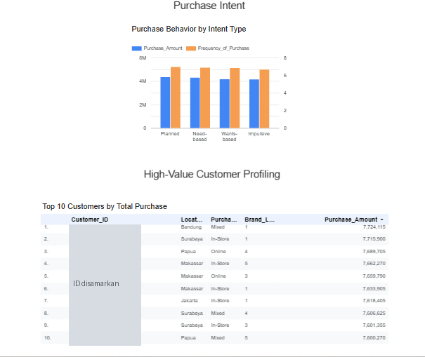

# Mission 4: Dashboard dan Analyst Report SuryaHub (Looker Studio)

Dashboard interaktif untuk tim Marketing dan Customer Experience SuryaHub, mencakup **6 key business area**, dilengkapi analyst report berisi insight dan rekomendasi yang dapat ditindaklanjuti.

**Dashboard:** [Buka di Looker Studio](https://datastudio.google.com/s/k7cDvaNKbqE)

**Ringkasan:** 499 pelanggan | Total revenue Rp2.118.220.545

## Tampilan Dashboard

## Insight per Key Business Area

| Area | Temuan | Rekomendasi |
|---|---|---|
| Customer Demographics & Segmentation | Gender seimbang (53,1% Female, 46,9% Male). Income Middle (250) dan High (249) hampir sama. | Kampanye dua jalur: value-oriented untuk Middle dan premium-oriented untuk High. |
| Geographic & Category Performance | Revenue tersebar merata di 6 kota. Makassar (Rp420 juta) dan Jakarta (Rp378 juta) tertinggi, Papua terendah (Rp313 juta). Kategori "Others" mendominasi revenue. | Prioritaskan Makassar dan Jakarta. Rapikan klasifikasi produk sebelum menyusun strategi kategori. |
| Loyalty Program Effectiveness | Non-member sedikit lebih tinggi dalam nilai dan frekuensi belanja dibanding member. Brand loyalty (skor 1 sampai 5) tersebar merata. | Redesain insentif (kurangi ketergantungan pada diskon) dan targetkan pelanggan dengan skor loyalitas 1 sampai 2. |
| Channel & Social Media Influence | Channel Mixed memiliki rata-rata pembelian tertinggi. Tingkat pengaruh sosial media tidak menunjukkan perbedaan nilai pembelian yang berarti. | Dorong strategi omnichannel dan evaluasi ulang anggaran social media marketing. |
| Purchase Intent | Empat tipe intent berdekatan, Planned sedikit unggul. | Dorong pembelian terencana dan manfaatkan pemicu promo untuk pembelian impulsif. |
| High-Value Customer Profiling | Top 10 pelanggan tersebar di banyak kota dan channel dengan Brand_Loyalty 1 sampai 5. Empat dari sepuluh memiliki skor 1. | Program retensi personal untuk top spender dengan loyalitas rendah. |

## Analyst Report

[Unduh analyst report (PDF)](reports/analyst_report_suryahub.pdf): ringkasan eksekutif, temuan per area, dan rencana uji coba personalisasi promosi selama 4 minggu (segmentasi, peluncuran, pengukuran repeat purchase rate dan revenue per customer).

## Tools
Looker Studio, Google Sheets (key insight), data dari analisis SQL pada [Mission 3](../03-sql-suryahub)
