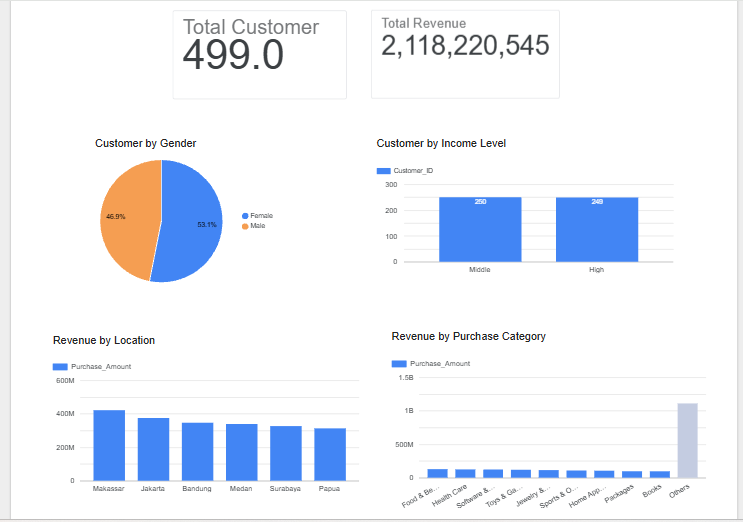

# SuryaHub Customer Analytics

Kumpulan mission analisis data pada studi kasus e-commerce dan kafe (SuryaMart, Kopi NangKau, SuryaHub): dari Excel, Python, dan SQL sampai dashboard serta rekomendasi strategis.

**Peran:** Junior Data Analyst | **Tools:** Excel (Pivot Table), Python (Google Colab: pandas, seaborn), SQL (BigQuery), Looker Studio

## Isi Repository

| No | Mission | Fokus | Tools | Folder |
|---|---|---|---|---|
| 1 | SuryaMart | Demografi, kategori produk, lokasi, diskon, dan pengaruh sosial media | Excel Pivot Table | [01-excel-suryamart](01-excel-suryamart) |
| 2 | Kopi NangKau | Pembersihan data, imputasi, analisis penjualan 2021-2023, dan 5 challenge | Python (Google Colab) | [02-python-kopi-nangkau](02-python-kopi-nangkau) |
| 3 | SuryaHub (SQL) | Loyalitas pelanggan dan perilaku belanja | SQL (BigQuery) | [03-sql-suryahub](03-sql-suryahub) |
| 4 | SuryaHub (Dashboard) | Dashboard 6 key business area dan analyst report | Looker Studio | [04-dashboard-suryahub](04-dashboard-suryahub) |

## Temuan Utama

**SuryaMart (Excel):** pelanggan perempuan dan income High menyumbang pembelian sedikit lebih besar, kategori gaya hidup (Jewelry & Accessories, Sports & Outdoors, Electronics) paling tinggi, dan diskon hanya berpengaruh lemah pada frekuensi belanja.

**Kopi NangKau (Python):** empat minuman terjual hampir sama banyak, Latte unggul di pendapatan karena harga, dan kenaikan pendapatan 2021-2023 (sekitar 1,4%) berasal dari kenaikan harga, bukan volume.

**SuryaHub (SQL dan Dashboard, 499 pelanggan, revenue Rp2.118.220.545):**
- Program loyalitas belum terbukti efektif: non-member justru sedikit lebih tinggi dalam nilai dan frekuensi belanja dibanding member.
- Pelanggan omnichannel (channel Mixed) memiliki rata-rata pembelian tertinggi (Rp4.459.349).
- Makassar dan Jakarta adalah kota prioritas.
- Kategori "Others" mendominasi revenue, sehingga klasifikasi produk perlu dirapikan sebelum strategi kategori disusun.

## Dashboard

[Lihat dashboard Looker Studio](https://datastudio.google.com/s/k7cDvaNKbqE)



## Struktur Repository

```
suryahub-customer-analytics/
├── 01-excel-suryamart/
├── 02-python-kopi-nangkau/
├── 03-sql-suryahub/
├── 04-dashboard-suryahub/
└── data/
```

## Catatan Data

Dataset berasal dari studi kasus (dataset latihan) pada program bootcamp. Data mentah tidak disertakan di repository ini. Lihat [data/README.md](data/README.md).

## Kontak

Keisha Aulia Nabil | [LinkedIn](ISI_LINK_LINKEDIN) | ISI_EMAIL
